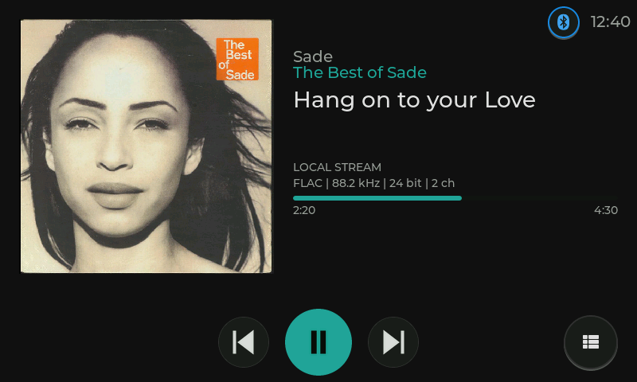
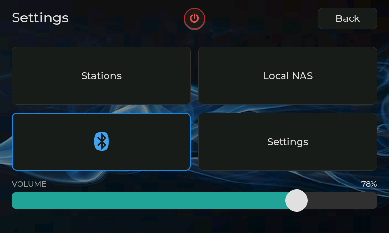
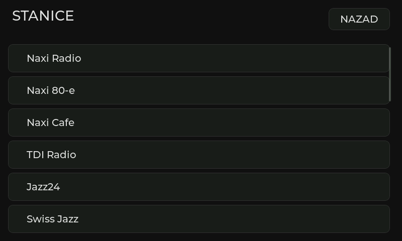
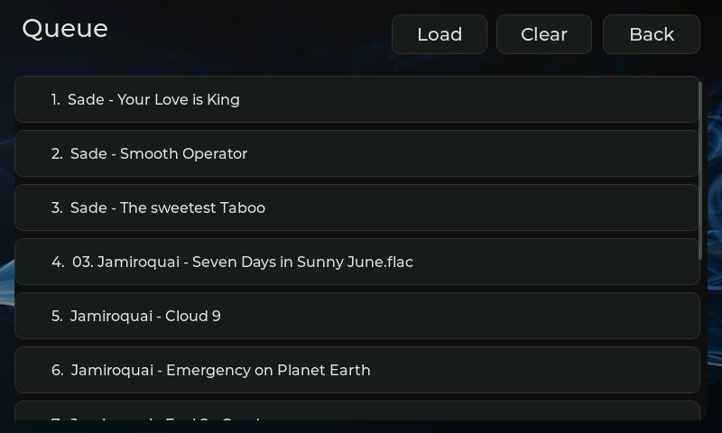
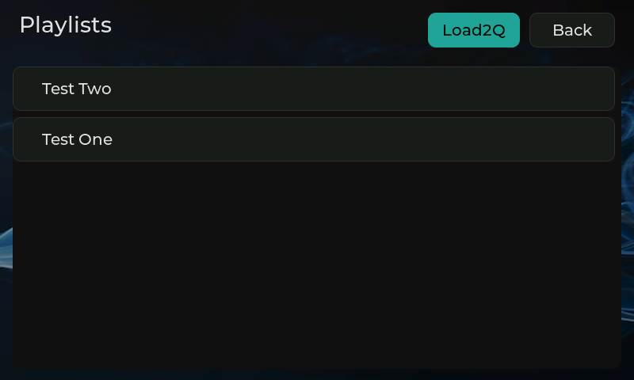
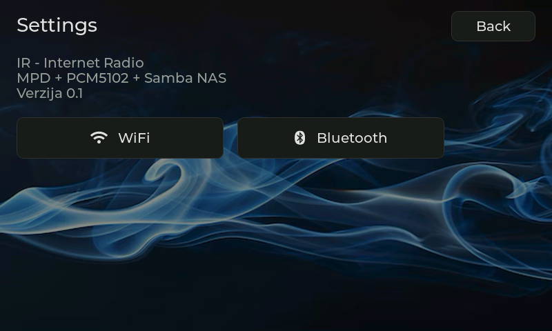
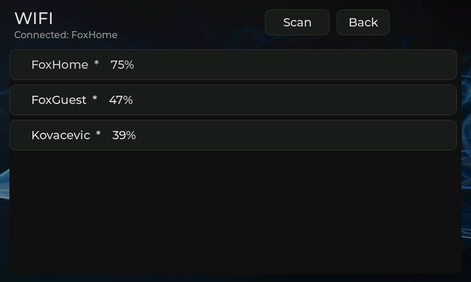
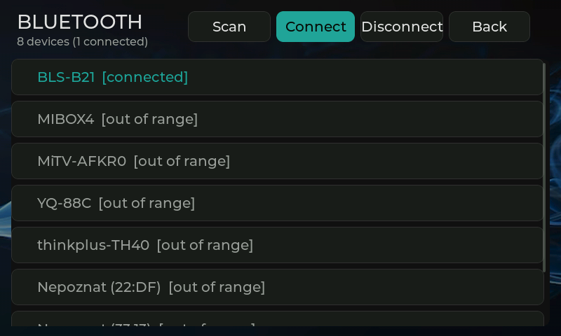
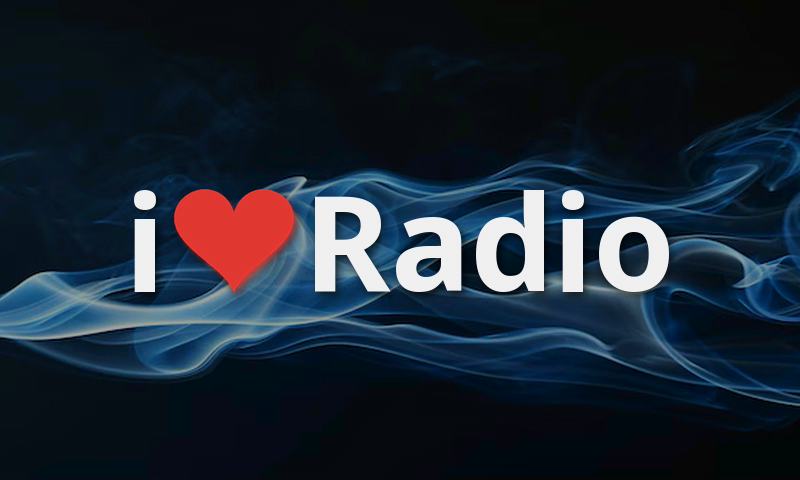

# iRadio — Internet Radio for Raspberry Pi 4B with DSI touchscreen

A lightweight, appliance-style internet radio / network player for the Raspberry Pi 4B.
The whole UI is written in C on **LVGL 9** and draws straight into the framebuffer —
no X, no Wayland, no browser. Audio is handled by **MPD** (Music Player Daemon) with
**PulseAudio** (system mode) routing to an I2S DAC or a Bluetooth (A2DP) speaker.
A web UI (**myMPD**) is available in parallel for library management and playlists.

**Version 1.0** (November 2026)

| Player | Menu |
|---|---|
|  |  |
| **Stations** | **Queue** |
|  |  |
| **Playlists** | **Settings** |
|  |  |
| **WiFi** | **Bluetooth** |
|  |  |
| **Boot splash** | |
|  | |

---

## 1. Hardware

| Part | Detail |
|---|---|
| SBC | Raspberry Pi 4 Model B (1 GB is enough; tested on 1.8 GiB) |
| Display | Waveshare 4.3" DSI, 800×480, capacitive touch (FT5x06 on I2C, `/dev/input/event4`) |
| DAC | PCM5102 on I2S (`hifiberry-dac` overlay) → ALSA card `sndrpihifiberry` |
| Bluetooth | on-board Pi BT (`hci0`), A2DP speaker |
| Network | `eth0` + `wlan0` (NetworkManager) |
| Storage | NAS share mounted read-only at `/mnt/nas` (CIFS) |

Wiring for the DAC (physical pins):

| PCM5102 | Raspberry Pi |
|---|---|
| VIN | 5 V (pin 2 or 4) |
| GND | pin 6 |
| BCK | pin 12 (GPIO18) |
| LRCK | pin 35 (GPIO19) |
| DIN | pin 40 (GPIO21) |

The DSI display needs only the flat cable; touch uses I2C (SDA/SCL/3V3/GND).

If you add a rotary encoder and buttons later (optional, not part of v1.0), the free
pins used by the reference build are GPIO 5/6 (encoder A/B), GPIO 13 (encoder push),
GPIO 16/20/26/12 (buttons). Do not use GPIO 18/19/21 (I2S), GPIO 2/3 (touch I2C).

---

## 2. Operating system

Install **Raspberry Pi OS Lite 64-bit (Debian 13 "trixie")** with the official imager,
enable SSH, boot once, then:

```bash
sudo apt update && sudo apt full-upgrade -y
sudo apt install -y git cmake build-essential
```

Set the hostname, timezone and locale:

```bash
sudo hostnamectl set-hostname inRadio
sudo timedatectl set-timezone Europe/Belgrade
```

### 2.1 Firewall / clock

No firewall is needed on a LAN; the radio only listens on MPD (6600) and myMPD (8080).
Make sure the clock is correct — the UI shows `HH:MM` from the local timezone:

```bash
timedatectl     # System clock synchronized: yes
```

---

## 3. Base packages

```bash
sudo apt install -y \
    mpd mpc \
    pulseaudio pulseaudio-utils pulseaudio-module-bluetooth \
    bluez alsa-utils \
    cifs-utils network-manager \
    libmpdclient-dev libpng-dev libjpeg-dev \
    fonts-dejavu-core
```

| Package | Why |
|---|---|
| `mpd`, `mpc` | playback engine + CLI for testing |
| `pulseaudio*` | system-wide mixer, DAC ↔ BT switching |
| `bluez` | Bluetooth stack |
| `cifs-utils` | NAS mount |
| `network-manager` | `nmcli` for the WiFi screen |
| `libmpdclient-dev` | MPD client library used by the UI |
| `libpng-dev`, `libjpeg-dev` | cover art decoding (FLAC pictures) |
| `cmake`, `build-essential` | build the UI |

Python helper scripts (building logos/splash) need Pillow:

```bash
sudo apt install -y python3-pil
```

---

## 4. Boot configuration

All boot files are on the FAT partition, mounted at `/boot/firmware`.

### 4.1 `config.txt`

```
dtoverlay=dwc2,dr_mode=host
dtoverlay=hifiberry-dac
dtparam=audio=off
disable_splash=1
```

- `hifiberry-dac` enables the PCM5102 I2S DAC (disables the on-board analogue audio).
- `disable_splash=1` removes the rainbow square. Raspberry Pi firmware does **not**
  draw a custom `splash.png` on the DSI panel — only on HDMI — so on DSI the screen is
  black until Linux is up (see §8).

### 4.2 `cmdline.txt`

Everything on **one line**:

```
quiet loglevel=0 logo.nologo vt.global_cursor_default=0 console=tty3 root=PARTUUID=... rootfstype=ext4 fsck.repair=yes rootwait cfg80211.ieee80211_regdom=RS
```

- `console=tty3` keeps kernel messages off the display.
- `vt.global_cursor_default=0` hides the blinking cursor.
- Do not remove `root=` / `rootfstype=` — keep your own values.

### 4.3 Disable the text console on the panel

```bash
sudo systemctl mask getty@tty1
```

`radio-ui.service` also runs `echo 0 > /sys/class/vtconsole/vtcon1/bind` before start,
which detaches the framebuffer console so boot messages never paint over the UI.

---

## 5. Storage (NAS)

```bash
sudo mkdir -p /mnt/nas
```

`/etc/fstab` (adjust server/share and uid — `mpd` must be able to read):

```
//blackbox.local/usbshare1 /mnt/nas cifs guest,ro,iocharset=utf8,vers=3.0,uid=mpd,gid=audio,file_mode=0644,dir_mode=0755,nofail,_netdev 0 0
```

```bash
sudo mount -a && ls /mnt/nas
```

Keep `uid=mpd` and world-readable modes (`0644/0755`) — myMPD runs as a dynamic user
and must be able to read covers from the same share.

---

## 6. Audio: MPD + PulseAudio

### 6.1 `/etc/mpd.conf`

```conf
music_directory     "/mnt/nas"
playlist_directory  "/var/lib/mpd/playlists"
db_file             "/var/lib/mpd/tag_cache"
state_file          "/var/lib/mpd/state"
sticker_file        "/var/lib/mpd/sticker.sql"
log_file            "/var/log/mpd/mpd.log"
user                "mpd"
bind_to_address     "any"

audio_output {
    type        "pulse"
    name        "Pulse"
    server      "unix:/run/pulse/native"
    mixer_type  "software"
}
```

`bind_to_address "any"` is required for myMPD. One Pulse output is enough — the
DAC/BT switch happens in PulseAudio, not in MPD.

```bash
sudo systemctl enable --now mpd
mpc status
```

### 6.1b MPD and the NAS mount

MPD must start **after** the CIFS mount, otherwise it indexes an empty directory at
boot and removes the whole database (`update: removing ...`). Drop-in:

```ini
# /etc/systemd/system/mpd.service.d/10-nas.conf
[Unit]
After=remote-fs.target
RequiresMountsFor=/mnt/nas
```

After adding files to the NAS: `mpc update` (or `mpc update "<folder>"`).

### 6.2 PulseAudio in system mode

The radio runs as a system service (no logged-in user), so PulseAudio must run
system-wide. `/etc/pulse/system.pa` needs these modules:

```
load-module module-native-protocol-unix auth-anonymous=1
load-module module-bluetooth-policy
load-module module-bluetooth-discover
```

`auth-anonymous=1` lets the `mpd` user connect to `/run/pulse/native`.

For hi-res material (WavPack/DXD 384 kHz, 32-bit float) `/etc/pulse/daemon.conf`:

```
default-sample-format = float32le
default-sample-rate = 48000
alternate-sample-rate = 44100
avoid-resampling = yes
resample-method = soxr-vhq
```

`avoid-resampling = yes` reopens the ALSA device at the rate of the current stream:
a 44.1 kHz radio stream stays 44.1 kHz, a 384 kHz WavPack file goes to the DAC as
`32-bit / 384 kHz` (PCM5102 handles it). Without it PulseAudio resamples everything
to `default-sample-rate`.

`/etc/systemd/system/pulseaudio.service`:

```ini
[Unit]
Description=PulseAudio system server
After=bluetooth.service
Wants=bluetooth.service

[Service]
Type=notify
ExecStart=/usr/bin/pulseaudio --system --disallow-exit --disallow-module-loading=no
Restart=always
RestartSec=2

[Install]
WantedBy=multi-user.target
```

```bash
sudo systemctl daemon-reload
sudo systemctl enable --now pulseaudio
```

### 6.3 DAC ↔ BT switching

`/opt/radio/pulse-switch.sh {dac|bt|restore}` switches the PulseAudio default sink and
moves the running stream:

- DAC sink: `alsa_output.platform-soc_sound.stereo-fallback`
- BT sink: `bluez_sink.<MAC>.a2dp_sink`

It stores the last used output in `/opt/radio/out-last`; `oir-out-restore.service`
restores it on boot (and reconnects the last BT speaker first).

### 6.4 Bluetooth speaker

`bt-pair.sh <MAC>` trusts, pairs and connects the device, forces the A2DP profile and
saves the MAC to `/opt/radio/bt-last`. `oir-bt-autoconnect.service` reconnects it on
boot. `Class=0x20041C` in `/etc/bluetooth/main.conf` makes the Pi advertise as a
speaker-friendly device.

---

## 7. myMPD (web UI)

myMPD is an independent web front-end for the same MPD. It is used for library
browsing, saving playlists (which the on-screen **Playlists** screen then loads) and
managing the queue from a phone/laptop.

```bash
. /etc/os-release        # expect VERSION_ID=13
curl -fsSL http://download.opensuse.org/repositories/home:/jcorporation/Debian_$VERSION_ID/Release.key \
  | sudo gpg --dearmor --yes -o /usr/share/keyrings/jcorporation.github.io.gpg
sudo chmod 644 /usr/share/keyrings/jcorporation.github.io.gpg
# verify: A37A ADC4 0A1C C6BE FB75 372F AA09 B8CC E895 BD7D
echo "deb [signed-by=/usr/share/keyrings/jcorporation.github.io.gpg] http://download.opensuse.org/repositories/home:/jcorporation/Debian_$VERSION_ID/ ./" \
  | sudo tee /etc/apt/sources.list.d/jcorporation.list
sudo apt update && sudo apt install -y mympd
```

Version 26 stores every setting as a file in `/var/lib/private/mympd/config/`:

```bash
# plain HTTP, no self-signed TLS warning
sudo sh -c 'printf false > /var/lib/private/mympd/config/ssl'
# let myMPD read covers/lyrics from the NAS (MPD albumart is broken on this setup)
sudo sh -c 'printf /mnt/nas > /var/lib/private/mympd/config/mpd_music_directory'
sudo chown nobody:nogroup /var/lib/private/mympd/config/{ssl,mpd_music_directory}
sudo chmod 600 /var/lib/private/mympd/config/{ssl,mpd_music_directory}
sudo systemctl restart mympd
```

Open **http://<pi-ip>:8080**. Save a playlist inside myMPD, then use
**Menu → Queue → Load** on the panel to append it to the queue.

---

## 8. Building and installing the UI

### 8.1 LVGL

The UI needs LVGL **9.2.x** sources (not packaged by Debian):

```bash
cd iRadio
git clone --depth 1 -b v9.2.2 https://github.com/lvgl/lvgl.git vendor/lvgl
```

`lv_conf.h` in the repo root is the tuned configuration (1 MB heap, Montserrat 14/16/20/
26/28/36/40 enabled, PNG/SVG decoders off — icons are compiled-in C arrays).

### 8.2 Build & install

```bash
./install.sh
```

The script builds `radio-ui`, installs:

```
/opt/radio/ui/build/radio-ui     binary
/opt/radio/ui/src/               sources (for on-device rebuilds)
/opt/radio/assets/               splash800.rgb565, bg800.rgb565, logos565/
/opt/radio/splash/               bootsplash, splash.raw, splash-loop.sh
/opt/radio/pulse-switch.sh, bt-pair.sh, bt-autoconnect.sh
/etc/systemd/system/*.service
```

and enables `radio-ui`, `oir-splash`, `pulseaudio`, `oir-bt-autoconnect`,
`oir-out-restore`.

### 8.3 `radio-ui.service`

```ini
[Unit]
Description=OIR Radio UI
After=mpd.service
Wants=mpd.service

[Service]
Type=simple
ExecStartPre=/bin/sh -c 'echo 0 > /sys/class/vtconsole/vtcon1/bind || true'
ExecStart=/opt/radio/ui/build/radio-ui --fb /dev/fb0 --touch /dev/input/event4
Restart=always
RestartSec=2

[Install]
WantedBy=multi-user.target
```

> **Do not** add `Before=mpd.service` here together with the inherited `After=mpd.service`
> — that creates a systemd ordering cycle and the UI is silently not started at boot.
> Keep `After=mpd.service`; the boot splash covers the time before the UI starts.

---

## 9. Boot splash chain

The screen is covered in three steps so the user never sees text or a rainbow:

| Phase | What it draws | Where |
|---|---|---|
| 1. firmware | *nothing on DSI* (rainbow disabled) | `disable_splash=1` |
| 2. early Linux | `splash.raw` (800×480 RGB565) | `oir-splash.service` + `tools/bootsplash.c` |
| 3. UI ready | same picture, then player | `radio-ui` splash screen |

**Step 2 — `oir-splash.service`**

```ini
[Unit]
Description=OIR boot splash (framebuffer)
DefaultDependencies=no
After=systemd-udevd.service
Before=sysinit.target radio-ui.service

[Service]
Type=simple
ExecStartPre=/bin/sh -c 'echo 0 > /sys/class/vtconsole/vtcon1/bind 2>/dev/null || true'
ExecStart=/opt/radio/splash/splash-loop.sh

[Install]
WantedBy=sysinit.target
```

`splash-loop.sh` waits for `/dev/fb0`, then redraws the image every 250 ms until the UI
creates `/run/oir-ui-ready` (max 20 s). Redrawing is needed because `vc4` replaces the
simple framebuffer during boot and blanks it once.

`tools/bootsplash.c` handles **16 bpp and 32 bpp** framebuffers (RGB565 and XRGB8888),
so it works both on the early simple-framebuffer and on the DRM framebuffer.

**Step 3 — UI hand-off**

`radio-ui` loads `/opt/radio/assets/splash800.rgb565`, shows it as the first screen, and
touches `/run/oir-ui-ready` on the **first LVGL flush** (`LV_EVENT_FLUSH_FINISH`). It
switches to the player when MPD answers (or after ~8 s).

**Regenerating the splash**

```bash
tools/make_splash.py                 # writes /tmp/splash.png (i♥Radio, heart drawn manually)
ffmpeg -i /tmp/splash.png -pix_fmt rgb565le -f rawvideo assets/splash800.rgb565
sudo install -m 644 assets/splash800.rgb565 /opt/radio/splash/splash.raw
sudo install -m 644 assets/splash800.rgb565 /opt/radio/assets/splash800.rgb565
```

The heart is drawn as a parametric curve; the bundled Noto font has no U+2665 glyph
(it renders `.notdef` — a rectangle).

**Background image**

`assets/bg800.rgb565` is drawn (55 % opacity, `BG_OPA` in `src/ui_pi.c`) behind every
screen. Regenerate any image with:

```bash
tools/make_bg.sh picture.avif        # avif/jpg/png → 800×480 RGB565 + installs on the Pi
```

---

## 9b. Audio Settings (DSP presets)

Settings → **Audio Settings** (speaker icon) toggles tone shaping for the DAC output
only; Bluetooth is unaffected.

| Preset | What it does |
|---|---|
| **DSP: Off** | bit-perfect path (MPD → Pulse → DAC) |
| **Clean** | high-pass 45 Hz, 12 dB/oct — removes sub-bass a small woofer cannot reproduce |
| **Clean + EQ** | Clean plus −10 dB peaking EQ @85 Hz (Q 1.4) — measured room/speaker peak in the reference room |

Presets were tuned from an in-room measurement (see the `Audio-Analyzer` project):
the reference room had a +11 dB peak at ~80 Hz, and this preset flattens 60–500 Hz to ±3 dB.

Implementation: a small LADSPA plugin (`tools/oir_dsp.c`, HPF + peaking + preamp) loaded
through PulseAudio `module-ladspa-sink` as two idle sinks (`oir_dsp_clean`, `oir_dsp_eq`).
Switching a preset only changes the default sink and restarts MPD, so nothing is
loaded/unloaded while audio is running. `audio-dsp.sh` keeps the state in
`/opt/radio/dsp-last`, `oir-dsp.service` loads the sinks at boot and the
`pulseaudio.service.d` drop-in restores the saved preset after any PulseAudio restart.

```bash
/opt/radio/audio-dsp.sh status        # off|clean|clean_eq
/opt/radio/audio-dsp.sh clean        # from a shell
```

Build dependency: `sudo apt install ladspa-sdk` (only needed to compile the plugin).

## 9c. Room measurement (optional)

Signals live in `assets/test-signals/` (FLAC 48k/24): log sweep 20 Hz–20 kHz (12 s),
pink noise (30 s) and a 1 kHz reference.

Measure with a second Pi (Zero 2W + **INMP441** I2S mic, wiring in
`docs/screenshots/inmp441-wiring.png`):

```
# /boot/firmware/config.txt on the measuring Pi
dtoverlay=googlevoicehat-soundcard
dtparam=audio=off

arecord -D hw:1,0 -f S32_LE -r 48000 -c 2 rec.wav      # INMP441 = left channel
```

Analysis (needs numpy+scipy, e.g. a venv):

```bash
python3 -m venv ~/.venvs/measure && ~/.venvs/measure/bin/pip install numpy scipy
~/.venvs/measure/bin/python tools/measure.py rec.wav --mode pink
~/.venvs/measure/bin/python tools/measure.py rec.wav --mode sweep
```

Output: 1/3-octave response (0 dB = 1 kHz), RT60 (sweep mode) and suggested parametric
EQ cuts for peaks 40–300 Hz. INMP441 is specified ±3 dB from ~60 Hz, so ignore the
lowest bands when judging sub-bass.

## 10. Using the radio

| Screen | What it does |
|---|---|
| **Player** | cover, station/artist/album, song title, format line, seek, volume indicator (top right), DAC/BT icon, prev/play/next, MENU |
| **Settings (menu)** | Stations · Output select · Local NAS · Settings · Queue, volume slider, Power (graceful `systemctl poweroff`) |
| **Stations** | 20 preset streams; playing station is highlighted in ochre and centred |
| **Local NAS** | browse folders (`.flac .mp3 .ogg .m4a .aac .wav .opus .wv .dsf .dff .aiff`); **tap a song = select** (ochre, multi-select); **Add to Queue** adds selected songs, or the whole folder when nothing is selected |
| **Queue** | MPD queue; tap a row to play it; **Load** → playlists; **Clear**; **Back** |
| **Playlists** | saved MPD/myMPD playlists; multi-select; **Load2Q** appends them to the queue |
| **Settings** | info, WiFi, Bluetooth |
| **WiFi / BT** | `nmcli` scan & connect, Bluetooth pair/connect with A2DP |

**Queue rules**

- Adding from **Local NAS** while a radio stream plays: the queue is cleared first, then
  the selected files are added and playback starts at the first added track.
- Adding while local music plays: tracks are appended, playback is not interrupted.
- The screen always stays where it is — use `Up` to pick another album.

**Output switch** — the round icon (player, top right) and the *Output select* button
(menu) toggle between DAC and Bluetooth; the choice is remembered across reboots.

**Keyboard / test hooks** (environment variables, useful while developing):

```bash
OIR_START=stations|local|settings|wifi|wifipass|bt|menu|queue|playlists|splash
OIR_SPLASH_HOLD=1      # keep the splash screen for screenshots
OIR_LOCAL_DIR=/mnt/nas/<dir>
```

---

## 11. Troubleshooting

| Symptom | Cause / fix |
|---|---|
| UI not started after boot, `NRestarts=0` | systemd **ordering cycle** between `radio-ui` and `mpd`. Check `systemctl show -p After radio-ui`; keep only `After=mpd.service` |
| Boot shows rainbow | `disable_splash=1` missing in `config.txt` (firmware cannot draw a custom splash on DSI) |
| Black screen for ~7 s before splash | DSI panel/framebuffer appears late; `oir-splash` can only draw after `/dev/fb0` exists |
| Splash disappears, black ~1 s | `oir-splash` stopped before the UI painted. Hand-off must be on `LV_EVENT_FLUSH_FINISH`, not a timer |
| Garbled splash colours | `bootsplash` built from source must support 32 bpp (early simple-framebuffer) |
| Squares instead of characters | LVGL's built-in Montserrat has no such glyph — use ASCII only in UI strings |
| Play/pause icon does not change | `mpd_client` encodes state as `1=play, 2=pause, 0=stop` |
| `Connection refused` on BT output | PulseAudio not running (`systemctl status pulseaudio`, socket `/run/pulse/native`) |
| BT falls back to mono 16 kHz | force the profile: `pactl set-card-profile bluez_card.<MAC> a2dp_sink` |
| MPD `albumart` → “No file exists” | known; the UI decodes the FLAC `PICTURE` block itself, myMPD uses `mpd_music_directory` |
| myMPD shows no covers | `mpd_music_directory` must be `/mnt/nas` and readable by the `mympd` dynamic user |
| WiFi connect fails from the UI | `nmcli` needs root; `radio-ui` runs as root, keep it that way |
| `vc4drmfb` warm restart leaves the screen black | `systemctl restart radio-ui` (the service rebinds fbcon) |
| UI runs out of memory | keep `LV_MEM_SIZE` at 1 MB in `lv_conf.h` |

---

## 12. Repository layout

```
iRadio/
├── src/                 UI sources (C, LVGL)
│   ├── ui_pi.c          all screens, timers, MPD glue
│   ├── mpd_client.c/h   minimal MPD client
│   ├── cover.c/h        FLAC/JPEG cover → RGB565
│   ├── icons.h          play/pause/next/prev bitmaps (ARGB8888 C arrays)
│   ├── icons_jack.h     audio-jack icon (generated)
│   ├── stations.h       the only file to edit for the station list
│   └── main.c           fbdev + evdev init
├── assets/              splash800.rgb565, bg800.rgb565, splash.png, logos565/
├── etc/                 mpd.conf, pulse/system.pa
├── systemd/             radio-ui, oir-splash, pulseaudio, BT/out restore units
├── tools/               bootsplash.c, splash-loop.sh, generators (PIL)
├── docs/screenshots/    UI screenshots
├── CMakeLists.txt       UI build
├── lv_conf.h            LVGL configuration
├── install.sh           build + install on the Pi
└── pulse-switch.sh, bt-pair.sh, bt-autoconnect.sh
```

---

## 13. Rebuilding the UI on the device

```bash
cd /opt/radio/ui && sudo mkdir -p build && cd build
sudo cmake .. && sudo make -j4
sudo systemctl restart radio-ui
```

Only `src/*.c|h` and assets need copying from the repo; LVGL itself is already built
(an `lv_conf.h` change triggers a longer rebuild, ~5–10 min on a Pi 4).

---

## 14. Credits

- UI: LVGL 9 (MIT) — https://lvgl.io
- Playback: MPD — https://www.musicpd.org
- Web UI: myMPD — https://github.com/jcorporation/myMPD
- Boot splash tool: `bootsplash.c` (this project)

Version 1.0 — 2026-11-11.
